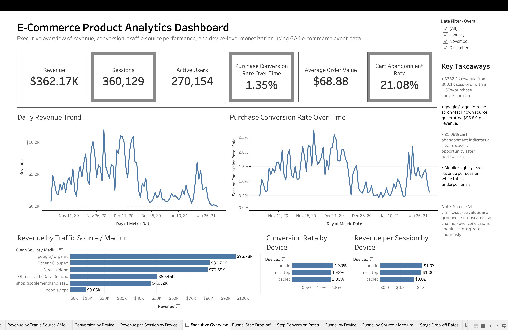
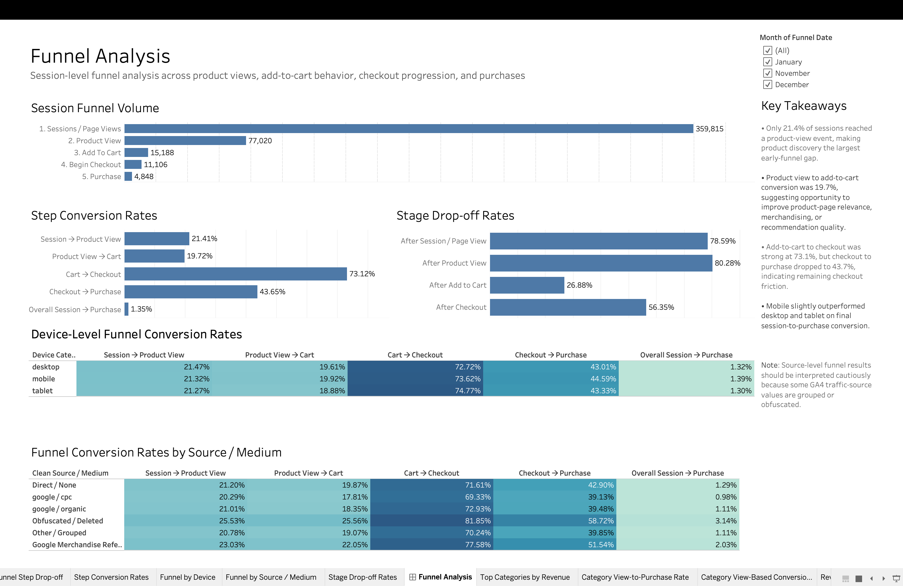
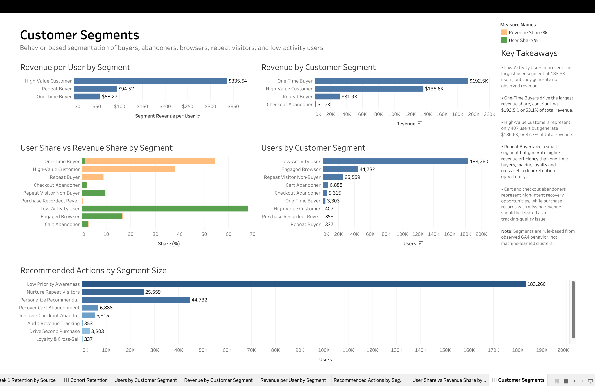
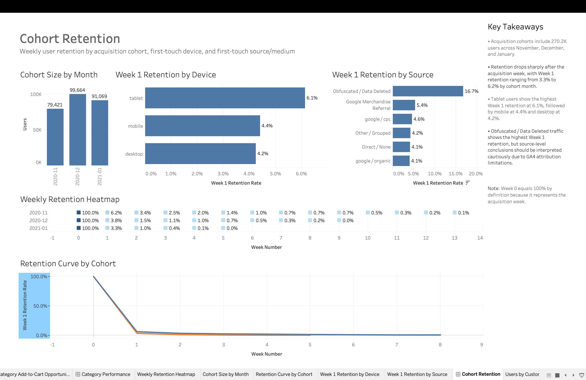
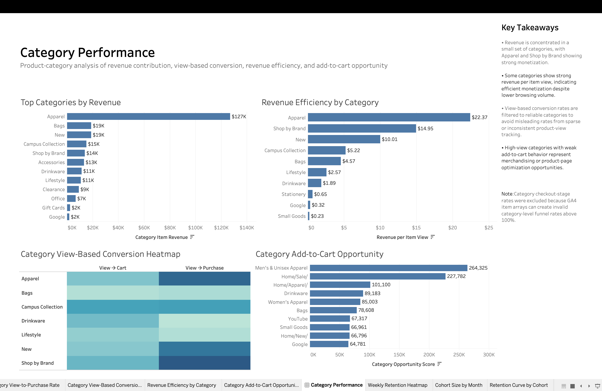
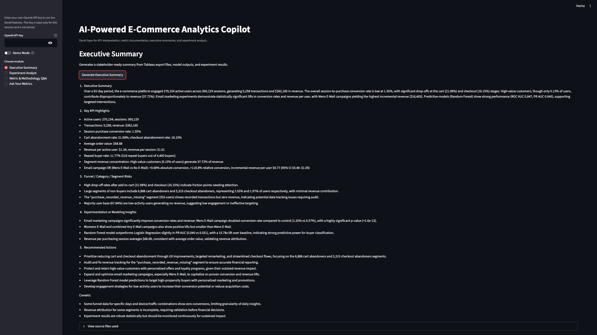
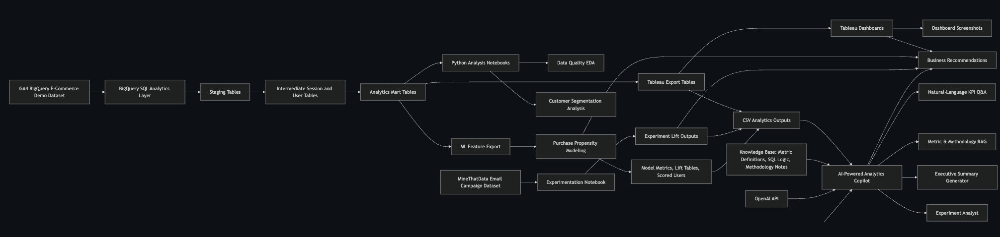

# E-Commerce Growth Case Study: Product Analytics, Experimentation & AI Copilot

**Only 1.35% of 360,129 sessions ended in a purchase. This project finds out why, decides what to fix first, and builds the tools to track it.**

🔗 [Live Tableau Dashboard](https://public.tableau.com/app/profile/yada.ugesh/viz/E-CommerceCampaignExperimentation/Dashboard1#1) · [Live AI Analytics Copilot](https://ecommerce-appuct-analytics-experimentation-ugesh.streamlit.app/) · [Full Case Study](reports/project_case_study.md)

---

## 🧭 Understanding the Problem

### 1️⃣ Context

| | |
|---|---|
| **About the company** | A Google Merchandise-style online store (GA4 e-commerce demo data): apparel, accessories and branded products sold online. |
| **About the industry** | E-commerce, where small gains in conversion and repeat purchase compound directly into revenue. |
| **Stakeholders** | **Executives** (where to invest?), **product managers** (where does the journey break?), **marketing** (which segments and campaigns work?), and **business users** (answers without SQL). |
| **Research** | Behavioural analysis of **360,129 sessions** and **270,154 users** in BigQuery: funnel, category, cohort and segment views, plus a randomised **email experiment** (MineThatData). |

### 2️⃣ Diagnosis

| | |
|---|---|
| **Pain points** | Only **1.35%** of sessions end in a purchase, and **21.08%** of carts are abandoned. Leadership cannot see *where* users drop off or *who* to focus on. |
| **Key takeaways** | Only **21.4%** of sessions ever view a product (biggest leak) · only **43.7%** of checkouts complete (second leak) · **407 high-value customers** drive **37.7%** of revenue · one-time buyers drive **53.1%**, so second purchases are a big opportunity. |
| **Benchmark view** | Add-to-cart → checkout is already strong (**73.1%**), so the problem is not intent but **discovery** and **checkout friction**. Mobile slightly outperforms desktop, so fixes should not be desktop-first. |
| **Trade-off** | Broad discounts for everyone vs. targeting likely buyers. The propensity model shows the **top 5%** of scored users buy at **9.9×** the base rate, so targeting wins. |

### 3️⃣ Strategy

| | |
|---|---|
| **User persona** | **Arjun, a growth product manager** *(illustrative persona)*. He needs to know which part of the funnel to fix first and how to prove the fix worked. |
| **Prioritisation** | ① Product discovery (biggest gap) → ② checkout friction → ③ roll out the winning email variant (**+0.68 pp** conversion). |
| **Solution** | A decision tool for every team: **5 Tableau dashboards** for PMs, a **buyer-propensity model** (0.847 ROC-AUC) for marketing, and an **AI copilot** anyone can ask without SQL. |
| **Implementation** | BigQuery SQL layers (staging → marts) → Tableau → scikit-learn model → A/B analysis with bootstrap confidence intervals → Streamlit copilot with RAG. Details in the engineering section below. |

### 4️⃣ Impact

| | |
|---|---|
| **Business impact** | A clear, ranked answer to "what should we fix first?", backed by funnel data rather than opinion. |
| **Financial impact** | Email outreach lifted revenue per user by **+$0.60** (95% CI $0.38 to $0.82), with the Mens variant at **+$0.77**. Retargeting the top 5% of scored users reaches buyers at **9.9×** the base rate. |
| **Risk & mitigation** | Demo data has limited price and margin context → recommendations are framed as tests, not guarantees · the experiment dataset differs from the GA4 site → methodology is shown, not a live rollout · model validated offline → used for ranking audiences only. |
| **Roadmap & metrics** | **Now:** roll out the Mens email; retarget the top 5% · **Next:** test search, navigation and product pages · **Later:** uplift modelling. **North star:** purchase conversion (1.35% baseline). |
| **Annexures** | [Full case study](reports/project_case_study.md) · [Detailed results](#-detailed-results) · [Dashboards](#%EF%B8%8F-dashboards) · [How to run](#%EF%B8%8F-how-to-run) |

---

## 📊 Detailed Results

### Product Analytics

| **Metric**               | **Value** |
| ------------------------ | --------- |
| Revenue                  | $362.17K  |
| Sessions                 | 360,129   |
| Active Users             | 270,154   |
| Purchase Conversion Rate | 1.35%     |
| Average Order Value      | $68.88    |
| Cart Abandonment Rate    | 21.08%    |

### Funnel Insights

- Only 21.4% of sessions reached a product-view event, making product discovery the largest early-funnel gap.
- Product view to add-to-cart conversion was 19.7%.
- Add-to-cart to checkout conversion was strong at 73.1%.
- Checkout to purchase conversion dropped to 43.7%, indicating remaining checkout friction.
- Mobile slightly outperformed desktop and tablet in session-to-purchase conversion.

### Category Insights

- Revenue was concentrated in a small set of categories.
- Apparel generated approximately $127K in revenue.
- Apparel and Shop by Brand showed strong monetization efficiency.
- High-view categories with weak add-to-cart behavior created merchandising and product-page optimization opportunities.

### Customer Segmentation

- Low-activity users were the largest segment, with 183.3K users and no observed revenue.
- One-time buyers drove the largest revenue share, contributing approximately $192.5K, or 53.1% of revenue.
- High-value customers represented only 407 users but generated approximately $136.6K, or 37.7% of revenue.
- Repeat buyers were small in count but had higher revenue efficiency than one-time buyers.
- Cart and checkout abandoners represent high-intent recovery opportunities.

### Purchase Propensity Modeling

| **Model**           | **ROC-AUC** | **PR-AUC** | **PR-AUC Lift vs Baseline** |
| ------------------- | ----------- | ---------- | --------------------------- |
| Logistic Regression | 0.846       | 0.031      | 12.4x                       |
| Random Forest       | 0.847       | 0.040      | 15.8x                       |

Additional lift results:

| **Audience**         | **Purchase Rate** | **Lift vs Baseline** |
| -------------------- | ----------------- | -------------------- |
| Top 1% scored users  | 6.27%             | 24.7x                |
| Top 2% scored users  | 4.50%             | 17.7x                |
| Top 5% scored users  | 2.50%             | 9.9x                 |
| Top 10% scored users | 1.76%             | 6.9x                 |

The model is best interpreted as a purchase-propensity ranking system rather than a strict binary classifier.

### Experimentation Results

| **Comparison**           | **Conversion Lift** | **Relative Lift** | **Revenue/User Lift** | **Revenue Lift 95% CI** |
| ------------------------ | ------------------- | ----------------- | --------------------- | ----------------------- |
| Mens E-Mail vs Control   | +0.68 pp            | +118.8%           | +$0.77                | $0.48 to $1.05          |
| Womens E-Mail vs Control | +0.31 pp            | +54.3%            | +$0.42                | $0.16 to $0.68          |
| Any E-Mail vs Control    | +0.50 pp            | +86.5%            | +$0.60                | $0.38 to $0.82          |

The email campaign produced statistically significant conversion and revenue lift. Mens E-Mail was the strongest overall campaign variant.

---

## 🖼️ Dashboards

**Executive Overview**


**Funnel Analysis**


**Customer Segments**


**Cohort Retention**


**Category Performance**


---

## 🤖 AI-Powered Analytics Copilot

A GenAI layer that turns the analytics outputs into an assistant for product, marketing and executive stakeholders:

1. **Executive Summary**: stakeholder-ready summaries from dashboard exports, model outputs and experiment results.
2. **Experiment Analyst**: interprets treatment vs control, conversion lift, revenue-per-user lift, bootstrap confidence intervals and rollout recommendations.
3. **Metric & Methodology Q&A**: retrieval-augmented answers over project documentation (metric definitions, SQL logic, modelling assumptions).
4. **Ask Your Metrics**: natural-language questions over curated KPI, segment, model and experiment outputs.

**Demo Mode** shows saved AI outputs without an API key.



---

## 🏗️ Architecture



```
GA4 event data (BigQuery)
   → SQL staging & intermediate layers (sessions, items)
   → Analytics marts (KPIs, funnel, cohorts, segments)
   → Tableau dashboards  +  ML feature export → propensity model (scikit-learn)
MineThatData email experiment → A/B analysis with bootstrap CIs
All outputs → AI copilot (Streamlit + RAG)
```

## 🧰 Tech Stack

- **Analytics engineering:** BigQuery SQL (staging → intermediate → marts)
- **Analysis & modelling:** Python, Pandas, NumPy, scikit-learn, SciPy, statsmodels
- **Visualisation:** Tableau
- **AI copilot:** Streamlit, OpenAI API, SentenceTransformers, FAISS

## 📁 Project Structure

```
sql/            BigQuery SQL pipeline (01_stg_events → 11_ml_user_features_export)
notebooks/      Data quality, propensity modelling, experimentation
dashboards/     Tableau workbook (.twbx)
ai_copilot/     Streamlit AI analytics copilot
reports/        Full project case study
images/         Dashboard and copilot screenshots
```

## ▶️ How to Run

```bash
# 1. Install dependencies
pip install -r requirements.txt

# 2. Run the SQL pipeline in BigQuery, in order (sql/01_* → sql/11_*)

# 3. Open the notebooks for modelling and experimentation
jupyter notebook notebooks/

# 4. Run the AI copilot (Demo Mode works without an API key)
pip install -r ai_copilot/requirements_ai.txt
streamlit run ai_copilot/app.py
```

## ⚠️ Limitations

- GA4 demo data is anonymised and has limited price, margin and marketing-spend context.
- The email experiment uses the MineThatData dataset, so it demonstrates methodology rather than a live campaign on the same site.
- The propensity model is validated offline and is best used for ranking audiences, not as a strict classifier.

See the [full case study](reports/project_case_study.md) for detailed methodology, recommendations and limitations.
